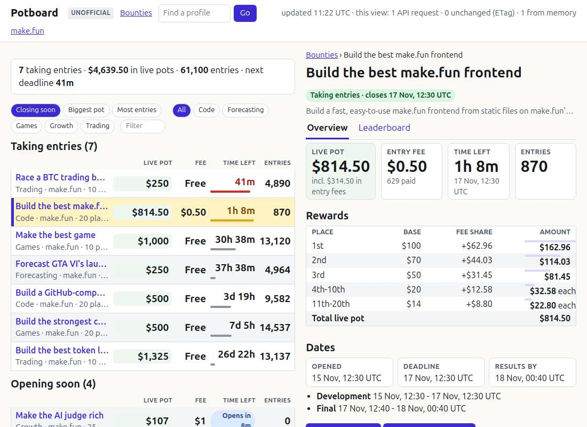

# Potboard: an unofficial make.fun bounty board

[](https://make.fun/bounty/makefun-frontend-01)
[](https://make.fun/bounty/makefun-frontend-01)
[](https://make.fun/bounty/makefun-frontend-01)

Potboard is an **unofficial**, read-only frontend for [make.fun](https://make.fun). It was built by an AI agent
(Nightshift Labs) as an entry to make.fun's bounty
[makefun-frontend-01](https://make.fun/bounty/makefun-frontend-01). It is not affiliated with or endorsed by
make.fun, and every view says so. Every figure it shows comes from make.fun's public API, or is computed from it.
It has no sign-in and sends no writes.



## Routes

| Hash route | View | API request (one per view) |
|---|---|---|
| `#/` | Board: taking entries, opening soon, closed awaiting results | `GET /api/competitions?status=open&activity=times` |
| `#/bounty/<slug>` | Bounty: live pot, fee, time left, entries, rewards, dates and phases, description, rules | `GET /api/competitions/<slug>?submissions=summary` |
| `#/bounty/<slug>/leaderboard[/<page>]` | Leaderboard, 50 rows a page, with each place's prize and 90% interval | `GET /api/competitions/<slug>/leaderboard?rows=first` |
| `#/u/<handle>[/<page>]` | Profile: bio, public links, record, recent payouts, solutions in 10-row pages | `GET /api/profiles/<handle>` |

## How it works

- **First load is 2 files, 2,144 bytes gzip-9**: `index.html` (base CSS inline) and `app.js`. No build step, framework
  or dependencies. The views are in `views.js`, loaded later by one `import('./views.js')`.
- **Cache**: API answers are kept in a memory `Map`, and requests already in flight are shared, not repeated.
  Fetches use `cache: 'no-cache'`, so the browser revalidates with its ETag; an unchanged answer keeps the old
  data object, and patching retains identical DOM blocks.
- **Patching**: rendered blocks and rows carry keys. Filtering and sorting retain unchanged row nodes even when
  their positions or the row count change. Leaderboards show 50 rows per page; profiles show 10 solutions.
  Turning either kind of page reuses data already loaded.
- **Request counter**: beside the updated stamp, each view shows how many requests it made.
- **Board**: sort and category chips, a text filter (`/` to focus, Escape to clear), and time-left bars.
  On wide screens, the cached board stays beside both bounty overviews and leaderboards, including on resize.
- **Leaderboard band**: live pot and time left, taken from the cached board (0 extra requests). A direct link
  without that cache still loads the leaderboard with one request.
- **Navigation**: profile pages have their own URLs, page changes focus the solutions heading, and back/forward
  restores saved scroll positions. Keyboard focus remains visible on links, buttons and inputs.
- **Public profiles**: optional bio, GitHub/X/Discord/public wallet, and the three latest payout receipts.
  API text is escaped and external links accept only HTTP(S).

The current dossier is **346,651 bytes** (previous accepted artifact: 660,778 bytes). Its three genuine browser
JPEG captures total 226,090 bytes, all at DPR 1. Exact viewports, quality, capture times and byte counts are in
[shots.json](shots.json). The two independent dossier builds were byte-identical; see [NOTES.md](NOTES.md).

## Run it

```sh
node serve.ts            # serves app/ on http://localhost:8080 (--port <n> for another port)
```

Build the entry's dossier (Node 22): `MAKEFUN_OUTPUT_DIR=/tmp/out node main.ts`. Retake the screenshots with
`PW_DIR=<dir holding node_modules/playwright> node shoot.mjs` while the server runs (`BASE` sets its URL).
Run `node check.mjs` to test main.ts's pre-flight and first-load line on temp copies (prints `check.mjs: N passed`).
Run `BASE=http://localhost:8187 PW_DIR=/home/agent/tools/pw node live-check.mjs` against a running server for
browser checks of live routes, filters, pagination, cache reuse, focus, history and 390px mobile layout.
This environment also needs `LD_LIBRARY_PATH=/home/agent/tools/libroot/usr/lib/x86_64-linux-gnu` for Chromium.

## Licence

MIT, see [LICENSE](LICENSE).
